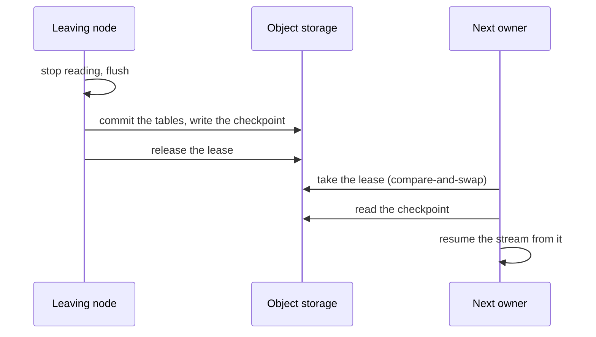

## Two planes

- **Membership is gossip.** Nodes probe each other over UDP (SWIM): a node that stops answering
  becomes *suspect*, then *down*, after about `4 × max(1, log10 n) × probe_interval` for `n`
  members. Every node computes the hash ring from the members it sees (`tokens` virtual nodes
  each), keyed on the pipeline's `id`, so every node proposes the same owner for a pipeline. A
  suspect node stays on the ring: a short network hiccup moves nothing.
- **Ownership is a lease.** The ring only proposes. Before a node reads a row of a pipeline it
  takes that pipeline's lease, an object in `globals.state`, with a compare-and-swap write, and it
  renews the lease every `lease_renewal_interval`. While one node holds the lease no other can take
  it, whatever the gossip says.

## Why there is one writer

A lease alone can't stop a node that has stalled (a long pause, a partition) and wakes up still
believing it owns the pipeline. Two more rules close that:

- **The safety deadline.** A holder stops writing on its own once its last successful renewal is
  older than `lease_duration × (1 − lease_safety_margin)` (12.75 s at the defaults). A challenger
  waits a full `lease_duration` (15 s) after the last renewal it saw before taking over, so the
  holder has stopped before anyone else starts.
- **The epoch fence.** Each lease term has an epoch, and every Delta commit carries the epoch of
  the term that wrote it. A commit from an older term than the table's last one is refused, and the
  node that tried stops the pipeline at once.

## A node leaves

A node that gets `SIGTERM` or `POST /v1/cluster/leave` hands its pipelines off:

Nothing is replayed, and the pipeline is back within seconds. A drain longer than `drain_timeout`
gives up: the pipeline is left to the next owner as if the node had died. The node answers the API
until it exits; its readiness probe fails while it leaves.

## A node dies

Its leases stop being renewed. Once the gossip marks it down, the next node on the ring for each
of its pipelines waits out the lease (`lease_duration` after the last renewal), takes it, and
resumes from the last checkpoint. The changes since then are replayed, and the sink's idempotence
makes the replay harmless (see [Delivery guarantees](/data-avalanche/architecture/delivery/)).

At the defaults a pipeline is unowned for about 20 seconds: a few seconds of detection, the 15 s
lease and a write. A node that inherits many pipelines starts at most
`max_concurrent_takeovers` (4) at once, with jitter.

## A node joins

A new node takes the pipelines the ring now gives it once membership has been stable for
`rebalance_stabilization` (15 s). Each moves by a planned hand-off from its current owner, at most
`max_concurrent_handoffs` (2) at a time per node. A node that restarts keeps its `node_name`, so
it gets the same pipelines back.

## The config

The cluster's config is a sequence of **generations** in `globals.state`. `POST
/v1/config/reload` on any node validates that node's file and publishes it as the next generation;
the gossip tells the other nodes, and each adopts it. A node resolves the generation's `${VAR}`s
with its own environment. `GET /v1/config/status` shows each member's generation; a node that
can't apply one (a variable it lacks) keeps the one it runs, logs why, and tries again.

A node that starts adopts the latest generation, not its file: see
[Config changes](/data-avalanche/runbooks/config-changes/).
