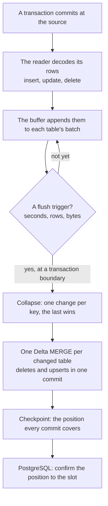

## Reading

- **PostgreSQL**: the pipeline's replication slot streams `pgoutput` messages from its
  publication. A transaction arrives whole, at its commit.
- **MySQL and MariaDB**: a binlog dump streams row events, positioned by GTID or by file and
  offset. The table's column names and types come with each event (`binlog_row_metadata = FULL`)
  and are checked against the schema the pipeline knows.

Each row is decoded into typed values, and gets its order in the source (`_seq`) and its
transaction (`_lsn`, `_ts`).

## Buffering and flushing

Rows wait in memory, per table, until a flush. A flush happens between transactions, never inside
one, when the first trigger of `sink.flush` is met. A transaction bigger than the buffer's cap
halts the pipeline, unless `max_transaction_batch_rows` lets it be committed in slices (see
[Sink and flushing](/data-avalanche/configuration/sink/)).

## Committing

The flush collapses each table's changes to at most one delete and one upsert per key, keeping the
last by `_seq`, and the sink runs one Delta MERGE per changed table: a row whose key the source
deleted is removed, the others are inserted or replaced. Each table's MERGE is one Delta commit,
atomic on its own; tables are committed one after the other, so a reader may see one table of a
flush before another.

A TRUNCATE at the source becomes a metadata-only delete of every row.

## Checkpointing

When every table of the flush is committed, the pipeline writes its checkpoint, the source position
the commits cover, to its state location. Then, on PostgreSQL, it confirms that position to the
slot, and the server may recycle the WAL behind it. MySQL and MariaDB keep no position for a
reader: the binlog stays as long as the server's own retention (`binlog_expire_logs_seconds`), so
a pipeline stopped for longer loses its position (see
[A lost position](/data-avalanche/runbooks/position-lost/)).

A crash between a commit and its checkpoint replays the changes since the last checkpoint. The
replay writes the same values again, and the sink skips a commit it has already made: see
[Delivery guarantees](/data-avalanche/architecture/delivery/).

## Order and visibility

- Within a table, changes apply in the source's order.
- A source transaction that wrote several tables appears in each table's commit of the same flush,
  but the tables' commits are separate: there's no atomic view across tables.
- The lag a reader sees is the time from the source's commit to the flush that carries it: up to
  `sink.flush.seconds` at steady state, plus the commit's time.
