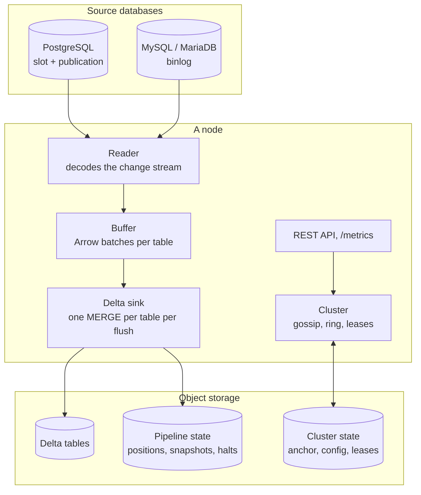

A node is one process. It runs the pipelines the cluster gives it, and serves the management API
and the metrics. Everything it must remember is in object storage, so any node can take over any
pipeline.

## A pipeline

A pipeline joins one source database to one sink location:

- **The reader** holds the source's change stream (a PostgreSQL replication slot, or a MySQL or
  MariaDB binlog dump) and decodes each row into typed values, with the table's schema as of that
  point in the stream.
- **The buffer** collects the decoded rows per table as Apache Arrow batches, a transaction at a
  time.
- **The flush** collapses the buffered changes to one per key (the last one wins), and the
  **sink** commits each changed table in one Delta MERGE: upserts and deletes together.
- **The checkpoint** then records the source position the commits cover, and the reader confirms
  it to the source, which may then release the WAL or binlog behind it.

A pipeline also runs its **snapshots** (copying existing rows beside the stream) and follows the
**schema** of its tables. [The data path](/data-avalanche/architecture/data-path/) follows one
change through these steps.

## The cluster

Each node gossips with the others (SWIM), and every node computes the same hash ring from the
members it sees. The ring proposes an owner for each pipeline; a **lease** in object storage,
taken with a compare-and-swap write, makes the owner the only writer. A node that dies stops
renewing its leases, and the next node on the ring takes them over when they expire.
[Cluster and failover](/data-avalanche/architecture/cluster/) has the details.

The cluster's config is also in object storage: a reload on any node publishes a new **config
generation**, and every node adopts it.

## State

| Where | What |
|---|---|
| a pipeline's state location | its desired state (running, paused, stopped), its source position, its snapshot cursors and jobs, its halted tables, its cached table schemas |
| `globals.state` | the cluster's anchor, the config generations, the members, one lease per pipeline |
| the Delta log | each commit's position and owner, which the sink reads back to never apply a change twice |

Each state file is small, versioned, and written with a conditional write, so two writers can't
overwrite each other.

## Further reading

The design is specified in the repository:
[System overview](https://github.com/alex-karpenko/data-avalanche/blob/main/doc/specs/System-Overview.md),
[Data flow](https://github.com/alex-karpenko/data-avalanche/blob/main/doc/specs/Data-Flow.md),
[Clustering](https://github.com/alex-karpenko/data-avalanche/blob/main/doc/research/Clustering_Architecture_Research.md).
