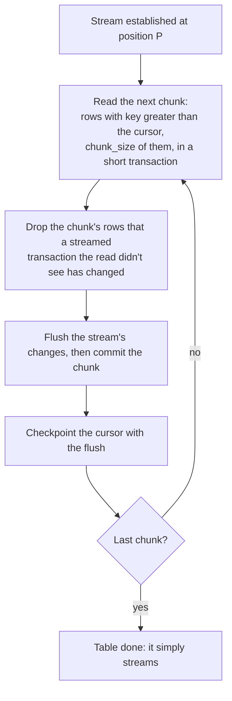

A snapshot copies a table's existing rows into its Delta table. It never stops the stream and never
holds a long transaction: the pipeline streams first, and reads each table in short keyset chunks
between stream transactions.

## Modes

`tables.snapshots.mode` (per table with `snapshots.overrides`) decides what a pipeline start does:

| Mode | At a pipeline start |
|---|---|
| `never` (the default) | no snapshot: stream the changes from now on |
| `initial` | snapshot a table that has never been replicated, then stream; skip one that has |
| `always` | snapshot every table at every start, then stream |
| `dump_initial` | snapshot a table that has never been replicated, then stop streaming it |
| `dump_always` | snapshot every table at every start, and stream nothing |

A pipeline whose tables are all `dump_*` and done shows `actual_state: dumped`.

## How a snapshot reads

- Each chunk is `chunk_size` rows (10000) in key order. The cursor is checkpointed with the flush
  that commits the chunk, so a crash resumes at the next chunk, never at the first row.
- A row the stream changes while the snapshot runs converges: the streamed change wins over the
  chunk's older copy.
- `parallelism` (1) tables are snapshotted at once; one table is read in order. On PostgreSQL each
  table being snapshotted holds about three connections: more than 4 at once warns (V-038).
- `source.timeouts.snapshot` (6 h) bounds one table's snapshot in one run; past it the table halts
  `SNAPSHOT_TIMEOUT`. Raise it and start a job for the table.

## Snapshot jobs

`POST /v1/pipelines/<id>/snapshots` with `{"tables": ["public.orders"]}` copies tables on demand,
named exactly as the config's per-table keys are (no patterns). The answer is `202` with the job's
id; `GET /v1/snapshots/<job_id>` follows it, `GET /v1/pipelines/<id>/snapshots` lists the
pipeline's jobs. Jobs are kept in the pipeline's state and survive restarts and failover.

- The pipeline restarts to take the job: its owner replays from its checkpoint and snapshots the
  job's tables from their first row, whatever their mode.
- A job's table that is halted has its halt cleared and its schema taken afresh from the catalog.
- A table the config doesn't replicate is copied once, and not streamed.
- A job **upserts**: it never deletes. A row deleted at the source while the table was halted, or
  not replicated, stays in the Delta table. To start clean, drop or move the Delta table first.

[Snapshot jobs](/data-avalanche/runbooks/snapshot-jobs/) is the runbook.
